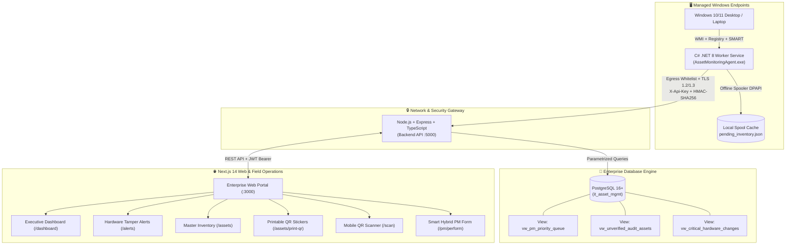

# 🛡️ Enterprise IT Asset Management, Audit & Preventive Maintenance System
### End-to-End Technical Architecture & Operations Runbook

---

## 📐 1. System Architecture Overview

The system is engineered as an enterprise-grade, resilient, three-tier architecture connecting Windows endpoints, central ingestion services, relational/JSONB storage, and responsive web/mobile technician applications:



---

## 🏛️ 2. Core Components

### 🖥️ Component 1: Windows Background Service Agent (.NET 8)
* **Location:** `C:\Users\meetingroom\Desktop\Programs-iBell\AssetMonitoringAgent.csproj`
* **Single-File Binary:** `bin\Release\net8.0-windows\win-x64\publish\AssetMonitoringAgent.exe` (~34.4 MB)
* **Execution Privileges:** Runs as `NT AUTHORITY\SYSTEM` with OS priority `ProcessPriorityClass.BelowNormal` to guarantee zero interference with user applications.
* **4 Security & Performance Pillars:**
  1. **Strict Egress Allowlist:** Validates URLs against internal domain/IP patterns before any network call.
  2. **Zero-Impact Throttling:** 5-second WMI query timeouts, random startup jitter (30–180s), and steady-state RAM `< 25MB`.
  3. **Data Integrity & Spooling:** DPAPI machine-key encryption for API secrets; local disk spooling (`pending_inventory.json`) with exponential backoff via Polly when offline.
  4. **Self-Updating Mechanism:** Polls for signed agent releases every 6 hours, verifies SHA-256 checksums, and hot-swaps binaries.

### 💾 Component 2: PostgreSQL 16+ Database Engine
* **Schema File:** `BackendAPI/init_schema.sql` (~18 KB)
* **Features:**
  - `UUID` primary keys (`gen_random_uuid()`)
  - `JSONB` columns with `GIN` indexing for dynamic hardware arrays (monitors, disks, installed software, PM checklists)
  - 3 Real-Time Operational Views:
    - `vw_critical_hardware_changes`: Flags unacknowledged RAM reductions and monitor serial swaps.
    - `vw_unverified_audit_assets`: Tracks assets missing from active stocktake campaigns.
    - `vw_pm_priority_queue`: Automatically schedules and sorts overdue/upcoming preventive maintenance tasks.

### 🛡️ Component 3: Hardened Backend API (Node.js/TypeScript)
* **Location:** `C:\Users\meetingroom\Desktop\Programs-iBell\BackendAPI`
* **Port:** `5000`
* **AppSec Layers (OWASP API Security Top 10):**
  - **Zod Schema Validation:** Sanitizes HTML/scripts from incoming strings (`sanitizeString`) to prevent Stored XSS in admin dashboards.
  - **Timing-Safe Auth:** `crypto.timingSafeEqual` prevents side-channel timing attacks on `X-Api-Key`.
  - **HMAC-SHA256 & Anti-Replay:** Validates signatures with a strict 5-minute epoch timestamp window.
  - **Automated Tamper Detection Engine:** Automatically compares incoming hardware snapshots with DB records and writes audit logs for RAM drops, monitor swaps, or serial mismatches.

### 💻 Component 4: Web Portal & Mobile Field Operations (Next.js 14)
* **Location:** `C:\Users\meetingroom\Desktop\Programs-iBell\Frontend`
* **Port:** `3000`
* **Core Modules:**
  - **Executive Dashboard (`/dashboard`):** Real-time KPI summary, System Hygiene risk table (Disk <15%, SMART errors, 100Mbps LAN downgrades, Uptime >30d), and dual-progress stocktake bar.
  - **Hardware Alerts (`/alerts`):** Side-by-side Old vs. New Diff viewer with color-coded badges and "Acknowledge & Resolve" modal.
  - **Master Inventory (`/assets`):** Search by host, tag, serial, user, or software; includes "Bind Asset Tag" modal for unregistered PCs.
  - **Printable QR Sticker Sheet (`/assets/print-qr`):** Print-ready grid for thermal or A4 sticker sheets encoding quick-action mobile URLs.
  - **Mobile QR Scanner (`/scan` & `/scan/[qrToken]`):** Uses mobile rear camera to scan chassis stickers; features One-Tap Stocktake Audit with location discrepancy detection.
  - **Smart Hybrid PM Form (`/pm/perform/[assetId]`):** Section A auto-fills live agent WMI metrics; Section B provides physical inspection toggles; Section C captures touch signatures exported as `< 100KB` Base64 PNGs.

---

## 🚀 3. Quick-Start & Operations Guide

### A. One-Click Start (Windows Host)
To start both Backend API and Frontend Portal in one command:
```powershell
powershell.exe -ExecutionPolicy Bypass -File .\Start-System.ps1
```
* **Frontend Portal:** `http://localhost:3000`
* **Backend API:** `http://localhost:5000`
* **API Healthcheck:** `http://localhost:5000/health`

### B. One-Click Stop
To gracefully terminate all running services:
```powershell
powershell.exe -ExecutionPolicy Bypass -File .\Stop-System.ps1
```

### C. Run Full Integration Tests
To re-verify the full stack (Unit tests, AppSec checks, Live HTTP 200 route checks):
```powershell
powershell.exe -ExecutionPolicy Bypass -File .\Scripts\Test-FullStack.ps1
```

### D. Docker Compose Deployment (All-in-One Linux / Server)
To spin up PostgreSQL 16, Backend API, and Frontend Portal in isolated containers:
```bash
docker compose up -d
```

---

## 📋 4. Test Verification Summary

| Component | Test Suite | Results | Status |
| :--- | :--- | :--- | :---: |
| **Windows Agent** | `tests/AssetMonitoringAgent.Tests` | 18 / 18 Passed | ✅ Verified |
| **Backend API** | `BackendAPI/tests/securityAndApi.test.ts` | 6 / 6 Passed | ✅ Verified |
| **Full Stack E2E** | `Scripts/Test-FullStack.ps1` | 9 / 9 Passed | ✅ Verified |
| **Next.js Frontend** | `next build` (Production Static/Dynamic) | 11 / 11 Routes | ✅ Verified |

